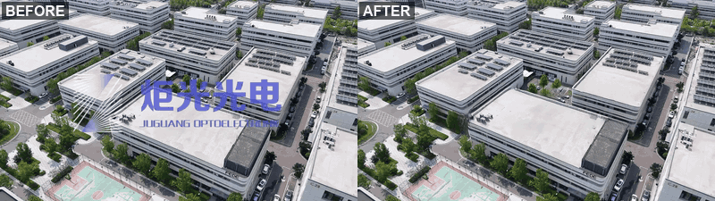
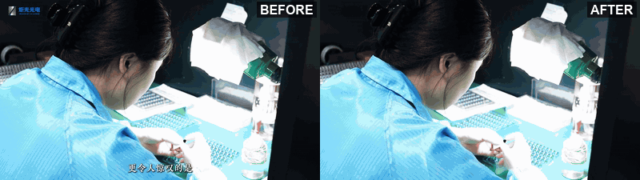
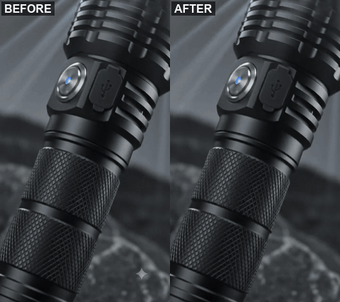
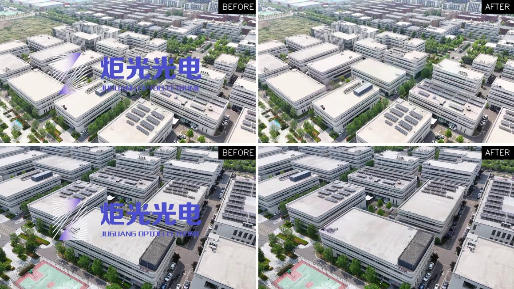
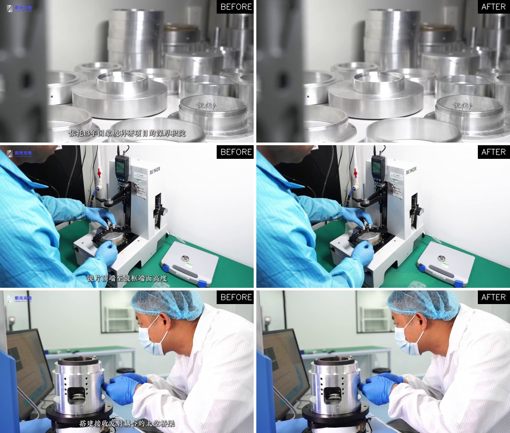
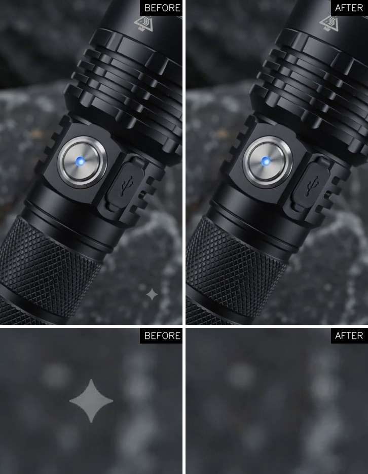
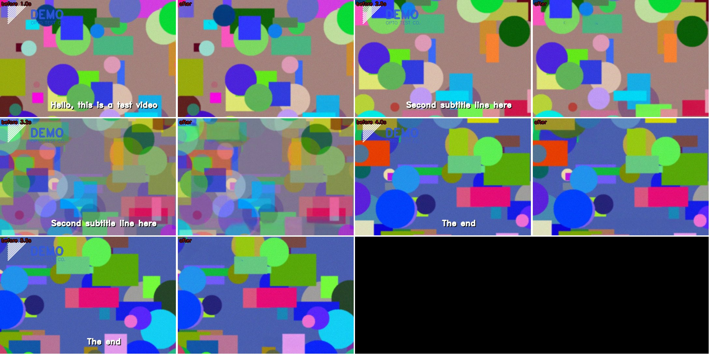

# video-watermark-remover-skill

<p align="center"><b>简体中文</b> | <a href="README.en.md">English</a></p>

<p align="center"><b>视频去水印 · 去 logo · 去台标 · 去字幕</b>　|　本地运行 · AI 助手（Claude Code / Codex）可直接调用</p>

本地视频**去 logo / 角标 / 台标 / 字幕**的工具集。底层用 [ProPainter](https://github.com/sczhou/ProPainter) 做视频修补，组织成一个 AI 编程助手（Claude Code、Codex 等）能照着执行的 **Agent Skill**。你只要说一句"把这个视频左上角的 logo 去掉"，助手会依次完成：

1. 自动定位元素的位置，以及它在哪些时间段出现；
2. 生成蒙版预览，**等你确认**；
3. 按镜头和转场分段修补，只改 logo 周围一小块，其余像素不动；
4. 用数值指标加逐秒抽帧做质检；
5. 交付成片、前后对比图，以及一份坐标文档（方便你叠新 logo、新字幕）。

脚本也可以脱离 AI 助手，直接在命令行用。

## 效果展示

**① 企业宣传片：画面正中的大 logo**（航拍运镜，logo 是半透明放射图标 + 品牌名 + 英文名）



**② 企业宣传片：左上角角标 + 底部字幕**（126 秒、160 个镜头段，全程去掉，方便重新配英文字幕）



**③ AI 生成视频（Veo / Gemini）右下角的星标水印**



<details>
<summary>静态对比大图（点击展开）</summary>





</details>

<sub>① 和 ② 的企业宣传片素材已获版权方授权，仅作效果演示，请勿另作他用。③ 只去掉画面上**可见**的星标；Google 嵌在 Veo 视频里的不可见 SynthID 水印不受影响。</sub>

## 能做什么 / 不能做什么
- ✅ 固定位置的 logo、角标、台标，包括半透明的、淡入淡出的，以及片头片尾转场里被拉糊的。
- ✅ 固定位置、水平居中、单行的字幕（指压在画面上的字幕，白字或深色字、带不带阴影都行；播放器里能开关的外挂字幕本来就不用去）。
- ⚠️ 会移动或缩放的 logo、滚动字幕、多行字幕：不能自动跟踪，需要手工指定时间段，效果会打折扣。
- ⚠️ 画面里本来就有的文字（标牌、屏幕上的字），如果和要去掉的元素重叠，会被一起抹糊。

## 安装

**需要**：NVIDIA 显卡（建议空闲显存 ≥4GB；只用 CPU 也能跑但非常慢）、Python 3.8+、git、ffmpeg。

```bash
git clone https://github.com/starx1n9/video-watermark-remover-skill.git
cd video-watermark-remover-skill/skills/video-watermark-remover

# 1) 建一个独立环境（conda 示例；用 venv 也行）
conda create -n vdw python=3.10 -y
conda activate vdw

# 2) 装 CUDA 版 PyTorch（按你的显卡和 CUDA 版本选，见 https://pytorch.org/get-started/locally/）
pip install torch torchvision --index-url https://download.pytorch.org/whl/cu121

# 3) 一键检查并安装其余依赖：会 clone 固定版本的 ProPainter，并写好 config.json
pip install -r ../../requirements.txt
python scripts/setup_env.py

# 4) 自检：合成一段已知真值的测试视频，跑完整流程，输出 PASS / FAIL（约 2 分钟）
python scripts/selftest.py
```

ffmpeg 安装方法：Windows 用 `winget install Gyan.FFmpeg`，macOS 用 `brew install ffmpeg`，Ubuntu 用 `sudo apt install ffmpeg`。

模型权重（约 200MB）会在第一次运行时自动下载。

## 配合 AI 助手使用

**Claude Code**：把 skill 目录放进 skills 目录。

```bash
# macOS / Linux
ln -s "$(pwd)/skills/video-watermark-remover" ~/.claude/skills/video-watermark-remover
# Windows (管理员 PowerShell 或开启开发者模式)
New-Item -ItemType SymbolicLink -Path "$HOME\.claude\skills\video-watermark-remover" -Target "$PWD\skills\video-watermark-remover"
```

放好之后直接说"去掉这个视频左上角的 logo"就会触发，也可以输入 `/video-watermark-remover`。

**Codex 和其他助手**：在本仓库根目录启动助手，它会读取 [`AGENTS.md`](AGENTS.md)，按里面的指引完成安装、自检，再按流程干活。如果你用的助手支持 Agent Skills（`SKILL.md` 格式），也可以把 `skills/video-watermark-remover` 放进它的 skills 目录。

**你需要提供的**：视频文件，再加一句话说明要去掉什么。时间段和位置会自动找出来，**修补开始前会先给你看蒙版预览，等你确认**。

## 不用 AI、直接命令行
完整的 8 步流程和每一步的参数含义见 [`skills/video-watermark-remover/SKILL.md`](skills/video-watermark-remover/SKILL.md)。下面是最短路径，以去掉左上角 logo 为例：

```bash
cd skills/video-watermark-remover
python scripts/locate_static.py --video in.mp4 --out-dir work                 # 找出不动的像素，看 work/static_rel.png
python scripts/mask_logo.py --rel work/static_rel.npy --box 0,0,200,90 --thresh 0.6 --preview in.mp4@100 --out-dir work
python scripts/shots.py in.mp4 --out work/bounds.json                          # 按硬切和转场分段
python scripts/inpaint.py --video in.mp4 --mask work/mask.npy --bounds work/bounds.json --workdir work/run --out in-nologo.mp4
python scripts/qc.py --orig in.mp4 --out in-nologo.mp4 --mask work/mask.npy --bounds work/bounds.json --workdir work/run --out-dir qc
```

去字幕时，把第 1、2 步换成 `mask_subtitle.py`，修补时用 `--masks work/masks.npz`。

## 为什么效果比"框一下整块抹掉"好（实测踩过的坑）
| 坑 | 现象 | 本工具的做法 |
|---|---|---|
| 转场没切开 | 静止镜头里冒出邻近镜头颜色的"药丸状色块" | 同时检测硬切和淡入淡出转场，转场两端都切开 |
| 细元素被整块盖住 | 补出来是一片"鳞片纹理" | 文字、射线按笔画抠，笔画之间的真实背景留给模型参考 |
| 修补区域太扁 | ProPainter 输出全黑 | 修补区域的宽和高都自动保证 ≥160 |
| 字幕蒙版逐帧变化 | 闪烁，淡入那几帧漏抠 | 同一句字幕从出现到消失共用一个蒙版，前后再各扩 3 帧 |
| 只看数值指标 | 指标全部通过，画面上却还有色块 | 质检强制输出逐秒联系图，要求人眼逐页过一遍 |

## 许可证与使用声明
- 本仓库代码采用 **MIT** 许可证，见 [LICENSE](LICENSE)。
- **ProPainter 不包含在本仓库里**，由 `setup_env.py` 从官方仓库拉取。它采用 **S-Lab License 1.0，仅限非商业用途**，商用需要联系原作者授权，详见 [THIRD_PARTY_NOTICES.md](THIRD_PARTY_NOTICES.md)。
- 请只处理你有权处理的素材。去除他人作品上的水印或版权标识，可能违反版权法或平台条款。
